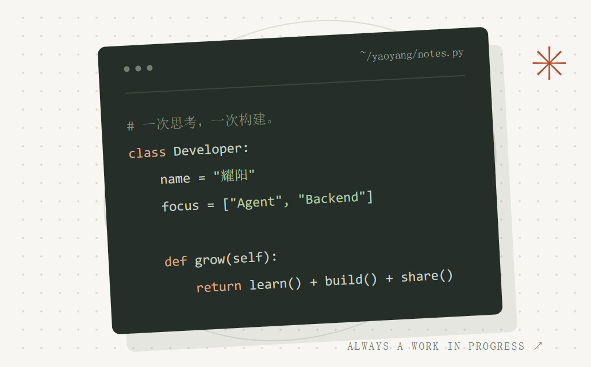

  
  

    
    <strong>I'm currently focused on Agent.</strong>
  

  

    <code>🐼 Born 2006.06</code>
    <code>📍 Now Base in Beijing.</code>
  

  
  &nbsp;&nbsp;
  <a href="https://liuyy682.github.io/">我的博客</a>

  <picture>
    <source media="(prefers-color-scheme: dark)" srcset="https://raw.githubusercontent.com/Liuyy682/Liuyy682/output/github-contribution-grid-snake-dark.svg">
    <source media="(prefers-color-scheme: light)" srcset="https://raw.githubusercontent.com/Liuyy682/Liuyy682/output/github-contribution-grid-snake.svg">
    
  </picture>

